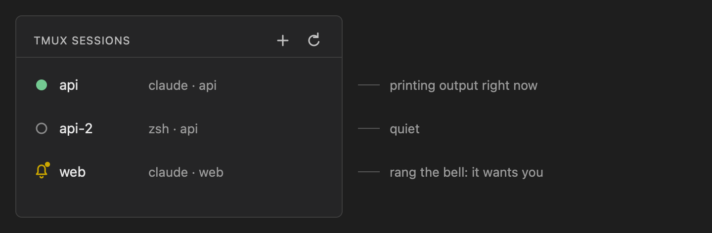

# tmux Sessions for VS Code

A sidebar for your tmux sessions. See which ones are busy, open one as an ordinary VS Code terminal, and create, rename or kill them, without leaving the editor.

The point of tmux here: **a session keeps running when you close its terminal tab, reload the window, or quit VS Code.** A long build, a dev server or an AI coding agent (Claude Code, Copilot CLI, ...) carries on, and you pick it up again later with one click, with its full output still there.

<p align="center"></p>

## What you get

- **A list of sessions** with a live dot: filled green while a session is printing output, a bell when it rang the terminal bell, a hollow circle when it is quiet. A count of sessions that rang the bell shows on the sidebar icon.
- **Click to open** a session as a terminal tab. Click again and the same tab comes to the front.
- **New Session Here** (the `+` button) starts a session in the folder you have open: a plain shell, or with a command of your choice already running in it.
- **Rename** and **Kill** from the right-click menu.
- **Separate from your own tmux.** By default the sessions live on a private tmux server (`tmux -L vscode`), so your existing tmux setup and its sessions are untouched.

No account, no network connection, no telemetry. The extension only runs the `tmux` program on your machine.

## Requirements

- macOS or Linux (also WSL and Remote-SSH: the extension runs where your folder is).
- tmux 3.0 or newer: `brew install tmux` or `sudo apt install tmux`.
- VS Code 1.90 or newer.

## Install

1. Download `tmux-sessions-<version>.vsix` from the [Releases](../../releases) page.
2. In VS Code: Extensions view → `...` menu → **Install from VSIX...**, or run `code --install-extension tmux-sessions-<version>.vsix`.
3. Click the new **tmux Sessions** icon in the activity bar.

To build the file yourself: `npm run package`.

## Settings

| Setting | Default | What it does |
|---|---|---|
| `tmuxSessions.socketName` | `vscode` | Which tmux server to use. A name selects a private server (like `tmux -L <name>`). Empty means your default tmux server, so the list shows the sessions you already have. |
| `tmuxSessions.newSessionCommands` | Shell, Claude, Claude (continue) | What **New Session Here** offers. Each entry has a `label` and a `command`; the command is typed into the new session. |
| `tmuxSessions.hideStatusLine` | `true` | Hide tmux's status line in sessions created here. |
| `tmuxSessions.refreshSeconds` | `5` | How often the list refreshes while visible. |
| `tmuxSessions.tmuxPath` | *(auto)* | Absolute path of tmux, if it is somewhere unusual. |

Example, offering your own tools:

```json
"tmuxSessions.newSessionCommands": [
  { "label": "Shell", "command": "" },
  { "label": "Copilot", "command": "copilot" },
  { "label": "Dev server", "command": "npm run dev" }
]
```

`socketName`, `newSessionCommands` and `tmuxPath` are read from your **user** settings only. A `.vscode/settings.json` inside a folder you open cannot change which program runs or what gets typed into your shell.

## Everyday use

| You want to | Do this |
|---|---|
| Start a session in this folder | `+` at the top of the list |
| Open a session | Click it |
| Leave it running | Close the terminal tab (or VS Code) |
| Rename or kill | Right-click the session |
| Reach it from a plain terminal | `tmux -L vscode attach -t <name>` |
| Scroll back | Mouse wheel (tmux's own history, kept while the session lives) |

All commands are also in the Command Palette under **tmux Sessions**.

## How it works

Short version: the terminal tab *is* tmux, attached to the session. Closing the tab detaches tmux; it does not stop anything. See [docs/how-it-works.md](docs/how-it-works.md) for the full picture, including what exactly happens on a rename.

## Limits worth knowing

- The green dot means "printed something in the last 10 seconds". A program that redraws constantly (a clock in a prompt, `top`) always looks busy.
- The bell icon depends on the program ringing the terminal bell. Many AI tools can do that when they finish or need input; check their settings.
- The list shows a session's active window. Sessions with several tmux windows work, but only the active one is described.
- Session names: letters, numbers, dashes and underscores. Sessions with other names are not listed.
- Windows without WSL is not supported (tmux does not run there).

## Development

```sh
npm test              # unit tests, plus a run against a real, throwaway tmux server
sh test/host/run.sh   # smoke test inside a real VS Code (opens a window for a few seconds)
npm run package       # build the .vsix
```

The code is two files: `lib.js` (pure functions that build every tmux argument list; fully unit-tested) and `extension.js` (the VS Code glue). No dependencies, no build step.

## License

MIT
